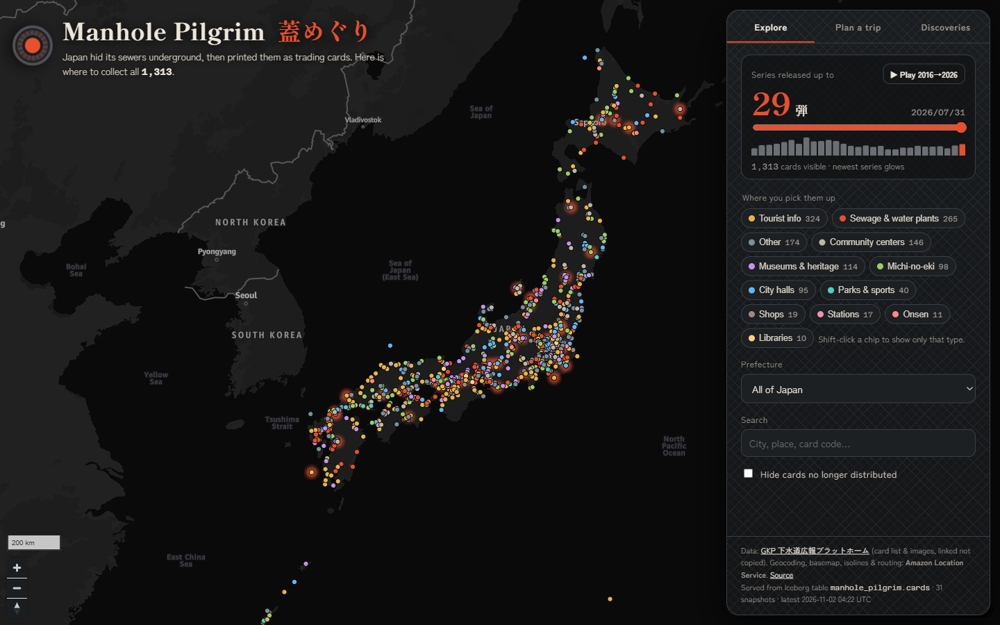
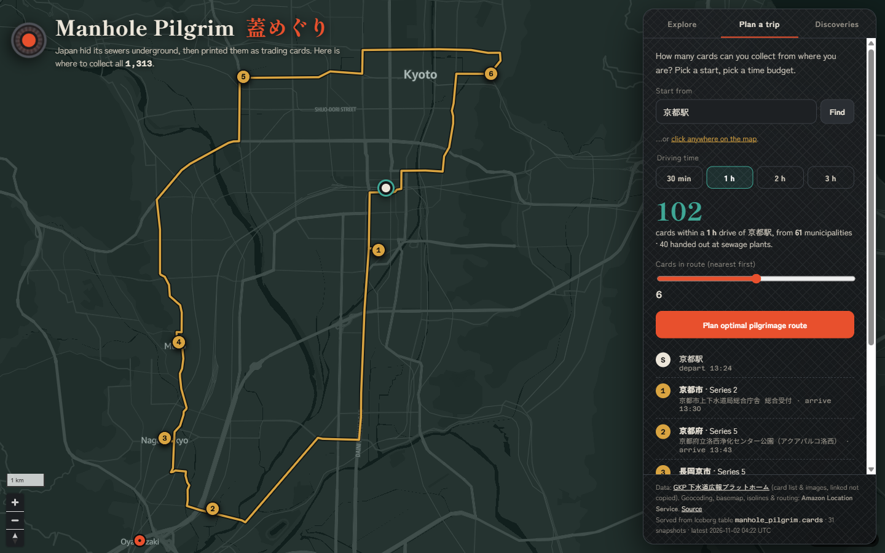
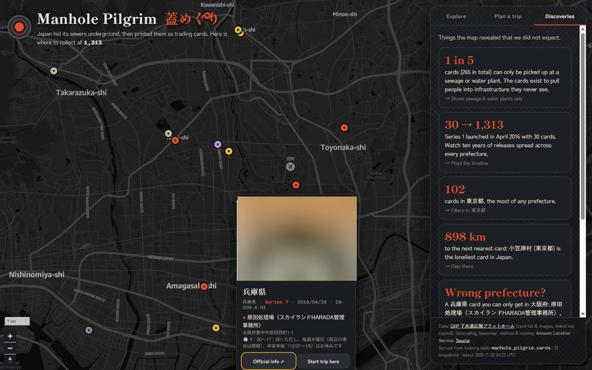

# Manhole Pilgrim 蓋めぐり

**Japan hid its sewers underground, then printed them as trading cards. This map shows where to collect all 1,313 of them.**

🗺️ **Live map:** https://main.d1y4wxk0wltj16.amplifyapp.com
🎬 **Demo video (< 3 min):** _add YouTube link here_



Since 2016, Japanese municipalities have issued **manhole cards** (マンホールカード): free collectible cards, each showing one decorated manhole cover. There is a catch. You can't buy, mail, or trade them online. You have to show up in person at one specific counter, often a city hall, a tourist office, or a **sewage treatment plant**. The cards are a public-relations tool built to get people to visit the infrastructure under their feet.

That makes them a geography problem, and a fun one:

- **Explore**: every card on one map, colour-coded by the kind of place that hands it out. Filter by series (1 to 29), prefecture, or place type. Search by city or card code.
- **Play ten years in ten seconds**: the timeline replays 2016 → 2026, one series at a time, with each new release glowing as it lands.
- **Plan a trip**: pick a starting point (search "京都駅" or click the map) and a driving budget. Amazon Location draws the area you can reach by car, counts the cards inside it, and plans an optimized pilgrimage route with arrival times.
- **Discoveries**: things the map revealed that we did not expect (below).

| Plan a trip: 102 cards within 1 h of Kyoto Station, 6-stop optimized loop | Discoveries: a Hyōgo card you can only get in Osaka |
|---|---|
|  |  |

## What the map revealed

- **1 in 5 cards (265) can only be picked up at a sewage or water plant.** The cards really do pull collectors into treatment plants.
- **Series 1 had 30 cards (April 2016); the collection is now 1,313 across all 47 prefectures.**
- **The loneliest card is Ogasawara's**: 898 km from the next nearest one, on an island reachable only by a 24-hour ferry.
- **A card in the wrong prefecture**: Hyōgo Prefecture's basin-sewer card is handed out at the Harada treatment plant, which physically sits in Toyonaka, **Osaka**. The geocoder flagged it as an outlier. It turned out to be true.
- **98 cards wait at michi-no-eki** (roadside stations): manhole cards are a road-trip game.
- **One hour of driving from Kyoto Station reaches about 100 cards in 60+ municipalities**, about 40 of them at sewage plants.

## The dataset

**Source:** [GKP 下水道広報プラットホーム (Sewerage PR Platform)](https://www.gk-p.jp/mhcard/), the official registry run by the manhole card programme. It has one HTML table per prefecture (47 pages).

**Fields per card:** issuing municipality, card code, series number (弾), issue date, card image URL, distribution place name, free-text address, opening hours, stock status.

**What it does not have:** coordinates. Distribution points are free-text Japanese addresses, and about 300 of them have only a place name (for example 「なよろ観光まちづくり協会」).

| | |
|---|---|
| Cards | **1,313** (series 1–29, 2016-04-01 → 2026-07-31) |
| Distinct distribution points | 1,274 |
| Located to street address | 1,005 |
| Located by place (POI) search | 299 |
| Fallback to municipality centroid | 9 (flagged in the UI, excluded from routing) |

## How it got on the map: Amazon Location Service

Amazon Location covers every geospatial step, and each API was picked for a specific job:

| Need | Amazon Location API | Why |
|---|---|---|
| Free-text Japanese address → coordinates | **Places `Geocode`** | Handles 大字/字/番地 style addresses and full-width digits (`山口県萩市大字江向６０２番地` → `江向602`, match score 1.0). |
| Place name only, no address → coordinates | **Places `SearchText`** biased to the municipality | Finds POIs like tourist associations and roadside stations. It also returns a **category**, which feeds the place-type classification. |
| Persist and republish geocodes | `IntendedUse: "Storage"` | Required when geocoding results are stored. Responses come back in the `Stored` pricing bucket. |
| Basemap | **Maps** `Monochrome` style, dark scheme | A dark map that lets the colour-coded "manhole" markers stand out. |
| "What can I reach in 1 h?" | **Routes `CalculateIsolines`** | Real drive-time polygons instead of naive circles. Its `SnappedOrigin` is reused for routing. |
| Best visiting order | **Routes `OptimizeWaypoints`** | Solves the travelling-salesman loop with arrival times. |
| Fallback ordering | **Routes `CalculateRouteMatrix`** + client-side 2-opt | Some start points (e.g. inside Sapporo Station) are reachable *from* but not *to* by car. In that case the app falls back to a one-way route ordered on real drive times. |
| Route geometry | **Routes `CalculateRoutes`** | Draws the road-following line. |

**Geocoding sanity checks.** Each result must land within 60 km of its municipality's own geocoded centroid. Prefecture-level cards (code `XX-000-…`) only need to land in the right prefecture. An address that explicitly names another prefecture wins over both rules, which is how the Hyōgo-in-Osaka card survived validation.

### Keeping a public map safe to leave online

A public map has to work for anonymous visitors. Anything the browser holds, anyone can copy, so the design caps what a copied credential can do and what abuse can cost:

| Layer | What it does |
|---|---|
| **Browser API key: tiles only** | The key in `web/config.js` allows only `geo-maps:GetTile`, only on `provider/default` in `ap-northeast-1`, only from the site's referer, and **expires on 2026-12-31**. It cannot call Places or Routes. |
| **Proxy for every paid call** (`infra/proxy.yaml`) | Place search, isolines, waypoint optimization, route matrix and routes go through **API Gateway (HTTP API) → AWS Lambda**. The Lambda IAM role holds the only permission to call those APIs. |
| **Server-built requests** | The Lambda builds each Amazon Location request itself. It accepts only coordinates inside Japan, drive times of 30/60/120/180 min, and at most 10 waypoints (11×11 matrix). Every other field is fixed server-side. |
| **Rate limit** | API Gateway allows 5 requests/s with a burst of 10, across all clients. |
| **Hard daily cap per operation** | A DynamoDB atomic counter rejects calls past the cap with HTTP 429. Defaults: search 1,000 · isolines 500 · optimize 300 · routes 600 · matrix 200 per UTC day. This bounds the worst-case daily bill no matter who calls. |

A visitor's request costs one Lambda call, about 100–200 ms more than calling Amazon Location directly. When `OptimizeWaypoints` fails, the proxy returns the error within about 4 s, and the browser falls back to the route matrix with 2-opt.

## Architecture

```mermaid
flowchart LR
  GKP["gk-p.jp/mhcard<br/>47 prefecture pages"] -->|scrape.py<br/>1.5 s polite delay| RAW[(raw HTML cache)]
  RAW -->|parse.py<br/>BeautifulSoup| CARDS[cards.json]
  CARDS -->|geocode.py| PLACES["Amazon Location<br/>Places: Geocode / SearchText<br/>IntendedUse=Storage"]
  PLACES --> GEO[cards_geo.json]
  GEO -->|build_geojson.py<br/>place-type classifier| JSONL[cards_enriched.jsonl]
  JSONL -->|lakehouse.py| S3RAW[("S3 raw/<br/>Athena JSON table")]
  S3RAW -->|"MERGE INTO<br/>(1 commit per series)"| ICE[("Apache Iceberg table<br/>manhole_pilgrim.cards<br/>S3 + Glue Data Catalog")]
  ICE -->|Athena SELECT| WEB["cards.geojson + lake.json"]
  WEB --> AMP["AWS Amplify Hosting<br/>(CloudFront CDN, HTTPS)"]
  AMP --> BROWSER["Browser: MapLibre GL"]
  BROWSER -->|"API key (GetTile only)"| MAPS["Amazon Location Maps<br/>tiles"]
  BROWSER -->|"search · isolines · routes"| APIGW["API Gateway HTTP API<br/>5 rps, burst 10"]
  APIGW --> LAMBDA["AWS Lambda proxy<br/>Japan-only validation"]
  LAMBDA <-->|daily cap counter| DDB[(DynamoDB)]
  LAMBDA -->|IAM role| LOC["Amazon Location<br/>Places SearchText · Routes"]
```



### Why Iceberg tables on S3

The card registry changes over time: new series every few months, cards that stop being distributed, counters that move. The pipeline treats every scrape as a **`MERGE INTO`** on an Apache Iceberg table (Parquet + zstd, partitioned by prefecture, queried with Amazon Athena):

- **Backfill replays history**: one Iceberg commit per series, so snapshot *n* is the collection as of series *n*.
- **Time travel works**: `pipeline/time_travel.py` runs `SELECT count(*) FROM cards FOR VERSION AS OF <snapshot>` and returns 30 cards (series 1), then 74 (series 2), and so on up to 1,313.
- **The table is the single source of truth**: the web GeoJSON is *exported from* Iceberg with an Athena query, never hand-built. The footer of the live site shows which snapshot it was served from.

```sql
-- How did the collection look after series 2?
SELECT count(*) AS cards, max(series) AS series
FROM manhole_pilgrim.cards FOR VERSION AS OF 5409628068825040900;
-- → 74 cards, series 2

-- Which cards changed in the last refresh?
SELECT * FROM "manhole_pilgrim"."cards$snapshots" ORDER BY committed_at DESC LIMIT 5;
```

### AWS services used

- **Amazon Location Service**: Maps, Places (Geocode, SearchText), and Routes (CalculateIsolines, OptimizeWaypoints, CalculateRouteMatrix, CalculateRoutes), plus a tiles-only API key with referer and expiry restrictions
- **Amazon API Gateway (HTTP API)** + **AWS Lambda**: rate-limited, validating proxy for every paid Location call (CloudFormation: `infra/proxy.yaml`)
- **Amazon DynamoDB**: per-operation daily quota counter
- **Amazon S3**: raw landing zone and Iceberg warehouse (public access blocked)
- **Amazon Athena**: DDL, `MERGE INTO`, time travel, export
- **AWS Glue Data Catalog**: Iceberg table metadata
- **AWS Amplify Hosting**: static site on a CloudFront CDN with HTTPS
- **Amazon Polly** (generative engine): demo video narration

## How the demo video is made

The video is a recording of the live app, not an edit. `?demo=1` runs a scripted tour on the real site with real Amazon Location calls, and the narration drives the timing:

1. `video/narration.json` holds one entry per segment: the spoken text, the on-screen caption, and the scene to show.
2. `python scripts/make_voice.py` voices each segment with **Amazon Polly** and writes the clip lengths to `web/demo_timing.js`. It also writes `video/narration.srt` and a CapCut (剪映) script.
3. Open `/?demo=1&wait=1` and start a screen recording, then call `window.__demoGo()`. A white slate cuts to black at t=0.
4. `python scripts/compose_video.py <recording.mp4>` finds that cut and places each Polly clip at the same offset `demo.js` used. It then loudness-normalizes the audio and refuses to output anything 3 minutes or longer.

To preview the tour with sound in the browser, open `/?demo=1&voice=1`.

## Reuse the pattern

Nothing here is specific to manholes. The same pipeline fits any "collect them in person" dataset that ships as addresses and changes over time: 御朱印 (temple stamps), 駅スタンプ (station stamps), michi-no-eki stamp rallies, dam cards (ダムカード), bridge cards, or brewery passports anywhere. Swap `scrape.py` and `parse.py` for your source. Everything from geocoding onward stays as it is.

## Deploy your own copy

There are two paths. **A** puts the map online in about 10 minutes, using the data already in `web/data/`. **B** rebuilds the dataset from the source registry through Amazon Location and Iceberg.

### Prerequisites

- An AWS account, and [AWS CLI v2](https://docs.aws.amazon.com/cli/latest/userguide/getting-started-install.html) configured with credentials (`aws sts get-caller-identity` works)
- Python 3.10+
- Region: everything is set up for **`ap-northeast-1` (Tokyo)**. To use another region, change `region` in `web/config.js` and `REGION` in `pipeline/geocode.py` and `pipeline/lakehouse.py`.
- Path B also needs `pip install requests beautifulsoup4 boto3`. The video tooling needs `ffmpeg`.

Your IAM identity needs these permissions:

| Path | Actions |
|---|---|
| A | `amplify:*` on your app; `geo:CreateKey`, `geo:DescribeKey`; `cloudformation:*` on the proxy stack, plus what it creates: `iam:CreateRole`/`PutRolePolicy`/`AttachRolePolicy`/`PassRole`, `lambda:*`, `apigateway:*`, `dynamodb:CreateTable`/`DescribeTable`/`UpdateTimeToLive`, `logs:CreateLogGroup`/`PutRetentionPolicy` |
| B (additionally) | `geo-places:Geocode`, `geo-places:SearchText`; `s3:*` on the lake bucket; `athena:StartQueryExecution`, `athena:GetQueryExecution`; `glue:*Database*`, `glue:*Table*`, `glue:*Partition*` |
| Video (optional) | `polly:SynthesizeSpeech` |

### A. Deploy the map (uses the committed data)

```bash
git clone https://github.com/cnusergroup/manhole-pilgrim && cd manhole-pilgrim
export AWS_REGION=ap-northeast-1

# 1. Create an Amplify Hosting app and branch (manual deployments, no Git connection)
APP_ID=$(aws amplify create-app --name manhole-pilgrim --platform WEB --query app.appId --output text)
aws amplify create-branch --app-id $APP_ID --branch-name main --stage PRODUCTION
echo "Your site will be https://main.$APP_ID.amplifyapp.com"

# 2. Deploy the Amazon Location proxy (API Gateway + Lambda + DynamoDB, CloudFormation) → prints proxyUrl
python scripts/deploy_proxy.py --origins "https://main.$APP_ID.amplifyapp.com,http://localhost:8765"
#    optional: --limits '{"isolines":200}' lowers individual daily caps (defaults in the table above)
python scripts/test_proxy.py <proxyUrl>      # 9 checks: every operation + the guard rails

# 3. Create the browser API key: map tiles only, your domain only, with an expiry date → prints apiKey
python scripts/create_map_key.py --referers "https://main.$APP_ID.amplifyapp.com/*,http://localhost:8765/*" --expires 2026-12-31 > key.txt
```

4. Write both values into **`web/config.js`**: `python scripts/set_config.py --key-file key.txt --proxy <proxyUrl>`. You can also edit `apiKey` and `proxyUrl` by hand. Point the "Source" link in `web/index.html` at your fork.
5. Preview it locally. The key allows `localhost:8765`.
   ```bash
   python -m http.server 8765 --directory web    # open http://localhost:8765
   ```
6. Deploy:
   ```bash
   # Windows PowerShell
   powershell -ExecutionPolicy Bypass -File scripts/deploy.ps1 -AppId <APP_ID>

   # macOS / Linux
   (cd web && zip -qr ../site.zip .)
   read JOB URL <<< $(aws amplify create-deployment --app-id $APP_ID --branch-name main --query "[jobId,zipUploadUrl]" --output text)
   curl -s -T site.zip -H "Content-Type: application/zip" "$URL"
   aws amplify start-deployment --app-id $APP_ID --branch-name main --job-id $JOB
   ```

Open `https://main.<APP_ID>.amplifyapp.com`. If the basemap is blank, check that the key's referer matches your URL exactly, including the trailing `/*`.

### B. Rebuild the data (Amazon Location + Iceberg on S3)

```bash
python pipeline/scrape.py               # caches the 47 source pages in data/raw (1.5 s between requests)
python pipeline/parse.py                # → data/cards.json
python pipeline/geocode.py              # → data/cards_geo.json; Amazon Location Places, cached in data/geocode_cache.json
python pipeline/build_geojson.py        # → data/cards_enriched.jsonl (+ web/data/cards.geojson)
python pipeline/lakehouse.py --backfill # creates bucket manhole-pilgrim-lake-<account-id>, Glue DB + Iceberg table,
                                        #   one MERGE commit per series, then exports web/data/cards.geojson + lake.json
python pipeline/time_travel.py          # optional: prints the card count at a few snapshots
```

To refresh later, run `scrape → parse → geocode → build_geojson`, then `python pipeline/lakehouse.py` without `--backfill` for one MERGE. Bump `dataVersion` in `web/config.js` and redeploy.

To adapt the pipeline to another dataset, replace `scrape.py` and `parse.py`. Everything downstream only expects `data/cards.json` records with a `pref`, `municipality`, `address`, `place_name`, `series`, and `id`.

### Re-make the demo video (optional)

See [How the demo video is made](#how-the-demo-video-is-made). In short: edit `video/narration.json`, run `python scripts/make_voice.py`, record `/?demo=1&wait=1`, then run `python scripts/compose_video.py <recording.mp4>`.

### Cost and clean-up

Expect a few US dollars at hackathon scale. Geocoding about 1,600 queries with `IntendedUse=Storage` is the largest one-off. After that, map tiles and routing are charged per visitor request. The proxy's daily caps bound routing and search spend. Lambda, API Gateway and DynamoDB cost cents at this scale. Athena scans are a few MB. Set an [AWS Budget](https://console.aws.amazon.com/billing/home#/budgets) alert if you leave the site up.

```bash
aws amplify delete-app --app-id $APP_ID
aws location delete-key --key-name manhole-pilgrim-tiles --force-delete
aws cloudformation delete-stack --stack-name manhole-pilgrim-proxy   # API Gateway, Lambda, DynamoDB, IAM role, log group
# path B only:
aws glue delete-table --database-name manhole_pilgrim --name cards
aws glue delete-table --database-name manhole_pilgrim --name raw_cards
aws glue delete-database --name manhole_pilgrim
aws s3 rb s3://manhole-pilgrim-lake-$(aws sts get-caller-identity --query Account --output text) --force
```

## Project layout

```
pipeline/   scrape → parse → geocode → build_geojson → lakehouse (Iceberg) → time_travel
web/        index.html, style.css, app.js (MapLibre + Amazon Location REST), config.js, data/
infra/      proxy.yaml (CloudFormation: API Gateway + Lambda + DynamoDB quota for Amazon Location)
scripts/    deploy.ps1 (Amplify), deploy_proxy.py, test_proxy.py, create_map_key.py, set_config.py,
            make_voice.py (Polly), compose_video.py, find_start.py
video/      narration.json (script), narration.srt, capcut_script.txt
docs/       screenshots
```

## Data, licensing, and limitations

- Card listings come from the official GKP registry. **Card images are not copied into this repo.** The live popup displays them from the official server and links back to the official page, and card art is blurred in the README screenshots. All card designs are © their issuing municipalities and GKP.
- `web/data/cards.geojson` holds factual listing data (place names, public addresses, opening hours, and links to the official images), plus coordinates we computed. It contains no personal data.
- The Amazon Location API key in `web/config.js` is a public, **tiles-only** browser key with a referer restriction and an expiry. See [Keeping a public map safe](#keeping-a-public-map-safe-to-leave-online). An earlier key with broader permissions appears in git history. It has been **deleted** in AWS and no longer works. Use your own key for your own deployment.
- Raw scraped pages and intermediate files are not committed (`.gitignore`). Re-create them with the pipeline.
- Distribution details (hours, stock) change. Always check the official link before travelling.
- Place types (sewage plant, tourist info, michi-no-eki, …) come from a keyword classifier on place names, plus Amazon Location POI categories. Around 13 % are "Other".
- The map shows where cards are **distributed**, not where the physical manhole covers are. The source registry does not publish cover coordinates.
- Basemap and geocoding data © AWS, HERE.

## License

Code: MIT. Data: see above.
