# Manhole Pilgrim 蓋めぐり

**Japan hid its sewers underground, then printed them as trading cards. This map shows where to collect all 1,313 of them.**

🗺️ **Live map:** https://main.d1y4wxk0wltj16.amplifyapp.com
🎬 **Demo video (< 3 min):** _add YouTube link here_


Since 2016, Japanese municipalities have issued **manhole cards** (マンホールカード): free collectible cards, each showing one decorated manhole cover. There is a catch. You can't buy, mail, or trade them online. You have to show up in person at one specific counter, often a city hall, a tourist office, or a **sewage treatment plant**. The cards are a public-relations tool built to get people to visit the infrastructure under their feet.

That makes them a geography problem, and a fun one:

- **Explore**: every card on one map, colour-coded by the kind of place that hands it out. Filter by series (1 to 29), prefecture, or place type. Search by city or card code.
- **Play ten years in ten seconds**: the timeline replays 2016 → 2026, one series at a time, with each new release glowing as it lands.
- **Plan a trip**: pick a starting point (search "京都駅" or click the map) and a driving budget. Amazon Location draws the area you can reach by car, counts the cards inside it, and plans an optimized pilgrimage route with arrival times.
- **Discoveries**: things the map revealed that we did not expect (below).

| Plan a trip: 102 cards within 1 h of Kyoto Station, 6-stop optimized loop | Discoveries: a Hyōgo card you can only get in Osaka |
|---|---|
|  |  |

## What the map revealed

- **1 in 5 cards (265) can only be picked up at a sewage or water plant.** The cards really do pull collectors into treatment plants.
- **Series 1 had 30 cards (April 2016); the collection is now 1,313 across all 47 prefectures.**
- **The loneliest card is Ogasawara's**: 898 km from the next nearest one, on an island reachable only by a 24-hour ferry.
- **A card in the wrong prefecture**: Hyōgo Prefecture's basin-sewer card is handed out at the Harada treatment plant, which physically sits in Toyonaka, **Osaka**. The geocoder flagged it as an outlier. It turned out to be true.
- **98 cards wait at michi-no-eki** (roadside stations): manhole cards are a road-trip game.
- **One hour of driving from Kyoto Station reaches about 100 cards in 60+ municipalities**, about 40 of them at sewage plants.

## The dataset

**Source:** [GKP 下水道広報プラットホーム (Sewerage PR Platform)](https://www.gk-p.jp/mhcard/), the official registry run by the manhole card programme. It has one HTML table per prefecture (47 pages).

**Fields per card:** issuing municipality, card code, series number (弾), issue date, card image URL, distribution place name, free-text address, opening hours, stock status.

**What it does not have:** coordinates. Distribution points are free-text Japanese addresses, and about 300 of them have only a place name (for example 「なよろ観光まちづくり協会」).

| | |
|---|---|
| Cards | **1,313** (series 1–29, 2016-04-01 → 2026-07-31) |
| Distinct distribution points | 1,274 |
| Located to street address | 1,005 |
| Located by place (POI) search | 299 |
| Fallback to municipality centroid | 9 (flagged in the UI, excluded from routing) |

## How it got on the map: Amazon Location Service

Amazon Location covers every geospatial step, and each API was picked for a specific job:

| Need | Amazon Location API | Why |
|---|---|---|
| Free-text Japanese address → coordinates | **Places `Geocode`** | Handles 大字/字/番地 style addresses and full-width digits (`山口県萩市大字江向６０２番地` → `江向602`, match score 1.0). |
| Place name only, no address → coordinates | **Places `SearchText`** biased to the municipality | Finds POIs like tourist associations and roadside stations. It also returns a **category**, which feeds the place-type classification. |
| Persist and republish geocodes | `IntendedUse: "Storage"` | Required when geocoding results are stored. Responses come back in the `Stored` pricing bucket. |
| Basemap | **Maps** `Monochrome` style, dark scheme | A dark map that lets the colour-coded "manhole" markers stand out. |
| "What can I reach in 1 h?" | **Routes `CalculateIsolines`** | Real drive-time polygons instead of naive circles. Its `SnappedOrigin` is reused for routing. |
| Best visiting order | **Routes `OptimizeWaypoints`** | Solves the travelling-salesman loop with arrival times. |
| Fallback ordering | **Routes `CalculateRouteMatrix`** + client-side 2-opt | Some start points (e.g. inside Sapporo Station) are reachable *from* but not *to* by car. In that case the app falls back to a one-way route ordered on real drive times. |
| Route geometry | **Routes `CalculateRoutes`** | Draws the road-following line. |

**Geocoding sanity checks.** Each result must land within 60 km of its municipality's own geocoded centroid. Prefecture-level cards (code `XX-000-…`) only need to land in the right prefecture. An address that explicitly names another prefecture wins over both rules, which is how the Hyōgo-in-Osaka card survived validation.

The browser talks to Amazon Location directly with an **API key**, so the app needs no backend. The key is restricted to the specific actions above, to the `provider/default` resources in `ap-northeast-1`, and to the site's referer.

## Architecture

```mermaid
flowchart LR
  GKP["gk-p.jp/mhcard<br/>47 prefecture pages"] -->|scrape.py<br/>1.5 s polite delay| RAW[(raw HTML cache)]
  RAW -->|parse.py<br/>BeautifulSoup| CARDS[cards.json]
  CARDS -->|geocode.py| PLACES["Amazon Location<br/>Places: Geocode / SearchText<br/>IntendedUse=Storage"]
  PLACES --> GEO[cards_geo.json]
  GEO -->|build_geojson.py<br/>place-type classifier| JSONL[cards_enriched.jsonl]
  JSONL -->|lakehouse.py| S3RAW[("S3 raw/<br/>Athena JSON table")]
  S3RAW -->|"MERGE INTO<br/>(1 commit per series)"| ICE[("Apache Iceberg table<br/>manhole_pilgrim.cards<br/>S3 + Glue Data Catalog")]
  ICE -->|Athena SELECT| WEB["cards.geojson + lake.json"]
  WEB --> AMP["AWS Amplify Hosting<br/>(CloudFront CDN, HTTPS)"]
  AMP --> BROWSER["Browser: MapLibre GL"]
  BROWSER -->|API key| LOC["Amazon Location<br/>Maps · Places · Routes"]
```



### Why Iceberg tables on S3

The card registry changes over time: new series every few months, cards that stop being distributed, counters that move. The pipeline treats every scrape as a **`MERGE INTO`** on an Apache Iceberg table (Parquet + zstd, partitioned by prefecture, queried with Amazon Athena):

- **Backfill replays history**: one Iceberg commit per series, so snapshot *n* is the collection as of series *n*.
- **Time travel works**: `pipeline/time_travel.py` runs `SELECT count(*) FROM cards FOR VERSION AS OF <snapshot>` and returns 30 cards (series 1), then 74 (series 2), and so on up to 1,313.
- **The table is the single source of truth**: the web GeoJSON is *exported from* Iceberg with an Athena query, never hand-built. The footer of the live site shows which snapshot it was served from.

```sql
-- How did the collection look after series 2?
SELECT count(*) AS cards, max(series) AS series
FROM manhole_pilgrim.cards FOR VERSION AS OF 5409628068825040900;
-- → 74 cards, series 2

-- Which cards changed in the last refresh?
SELECT * FROM "manhole_pilgrim"."cards$snapshots" ORDER BY committed_at DESC LIMIT 5;
```

### AWS services used

- **Amazon Location Service**: Maps, Places (Geocode, SearchText), and Routes (CalculateIsolines, OptimizeWaypoints, CalculateRouteMatrix, CalculateRoutes), plus an API key with action, resource, and referer restrictions
- **Amazon S3**: raw landing zone and Iceberg warehouse (public access blocked)
- **Amazon Athena**: DDL, `MERGE INTO`, time travel, export
- **AWS Glue Data Catalog**: Iceberg table metadata
- **AWS Amplify Hosting**: static site on a CloudFront CDN with HTTPS

## Reuse the pattern

Nothing here is specific to manholes. The same pipeline fits any "collect them in person" dataset that ships as addresses and changes over time: 御朱印 (temple stamps), 駅スタンプ (station stamps), michi-no-eki stamp rallies, dam cards (ダムカード), bridge cards, or brewery passports anywhere. Swap `scrape.py` and `parse.py` for your source. Everything from geocoding onward stays as it is.

```bash
pip install requests beautifulsoup4 boto3
python pipeline/scrape.py              # cache source pages (polite, once)
python pipeline/parse.py               # → data/cards.json
python pipeline/geocode.py             # → data/cards_geo.json (Amazon Location Places, cached)
python pipeline/build_geojson.py       # → data/cards_enriched.jsonl (+ web/data/cards.geojson)
python pipeline/lakehouse.py --backfill  # first run: Iceberg table, 1 commit per series, export
python pipeline/lakehouse.py           # later runs: single MERGE + export
python pipeline/time_travel.py         # demo Iceberg time travel

# local preview
python -m http.server 8765 --directory web
# deploy (Amplify manual deployment)
powershell -ExecutionPolicy Bypass -File scripts/deploy.ps1
```

You need AWS credentials with Location (Places/Routes), S3, Athena, and Glue permissions, plus your own Amazon Location API key in `web/config.js`. The key needs `geo-maps:GetTile`, `geo-places:SearchText`, and `geo-routes:CalculateIsolines|CalculateRoutes|CalculateRouteMatrix|OptimizeWaypoints`, restricted to your domain.

## Project layout

```
pipeline/   scrape → parse → geocode → build_geojson → lakehouse (Iceberg) → time_travel
web/        index.html, style.css, app.js (MapLibre + Amazon Location REST), config.js, data/
scripts/    deploy.ps1 (Amplify Hosting manual deploy)
docs/       screenshots
```

## Data, licensing, and limitations

- Card listings come from the official GKP registry. **Card images are not copied.** The popup displays them from the official server and links back to the official page. All card designs are © their issuing municipalities and GKP.
- Raw scraped pages and intermediate files are not committed (`.gitignore`). Re-create them with the pipeline.
- Distribution details (hours, stock) change. Always check the official link before travelling.
- Place types (sewage plant, tourist info, michi-no-eki, …) come from a keyword classifier on place names, plus Amazon Location POI categories. Around 13 % are "Other".
- The map shows where cards are **distributed**, not where the physical manhole covers are. The source registry does not publish cover coordinates.
- Basemap and geocoding data © AWS, HERE.

## License

Code: MIT. Data: see above.
