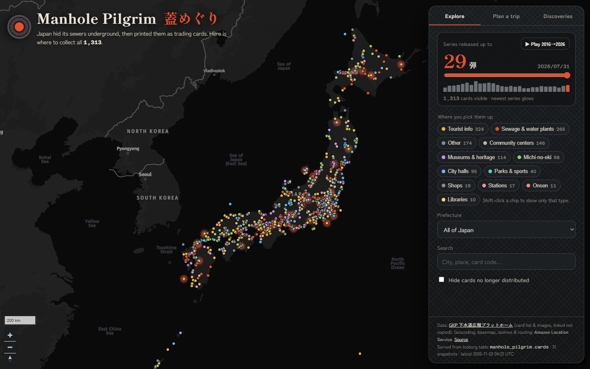
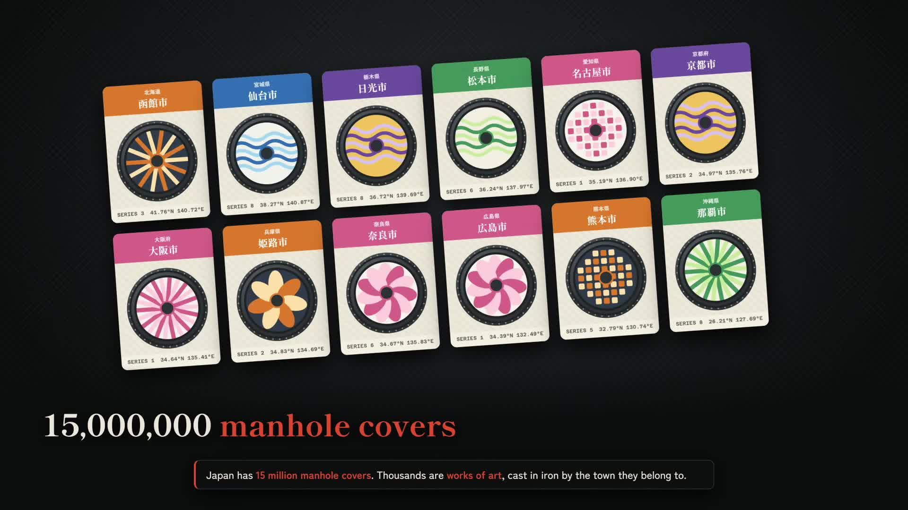
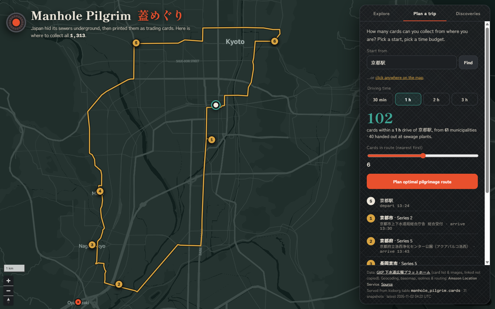
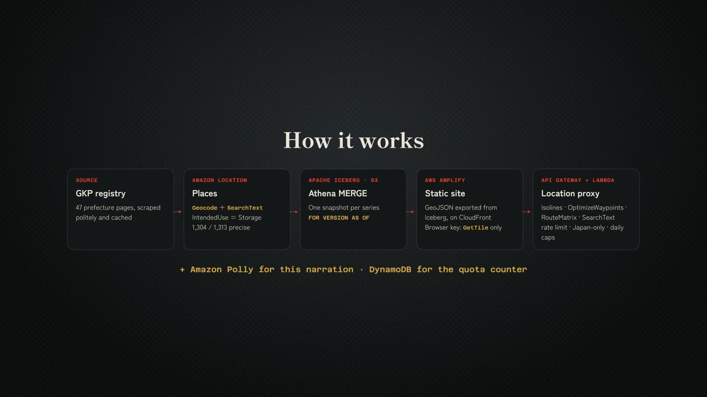

# Manhole Pilgrim: mapping all 1,313 Japanese manhole cards with Amazon Location Service and Apache Iceberg on S3

**Japan hid its sewers underground, then printed them as trading cards. I put all 1,313 on one map, so a traveller can see how many they can collect this weekend and get a route.**

- 🗺️ **Live map:** https://main.d1y4wxk0wltj16.amplifyapp.com
- 🎬 **Demo video (2:33):** _YOUTUBE_LINK_
- 💻 **Code (MIT):** https://github.com/cnusergroup/manhole-pilgrim





## Why manhole cards

Japan has about 15 million manhole covers, and thousands of them are works of art. Towns cast their castles, festivals, flowers and mascots into the iron. Since 2016, local sewer agencies and the Sewerage PR Platform (GKP, 下水道広報プラットホーム) have turned these designs into **manhole cards** (マンホールカード). The cards are free, and each one shows a cover, its coordinates and its story.

They come with one rule: **you can't buy them, mail-order them or trade them online.** You walk up to one specific counter, in one specific town, and ask. That makes them a good fit for travellers:

- **A free souvenir** in every town that issues one.
- **A reason to leave the tourist trail.** There are 1,313 cards from 783 issuers, most of them in towns you would never otherwise visit.
- **On your way anyway.** 536 cards are handed out at tourist information offices, michi-no-eki roadside stations and museums.

There is a catch, though. The official list is 47 prefecture pages of free-text Japanese addresses, and it has no map.

## The dataset

| | |
|---|---|
| Source | Official registry at [gk-p.jp/mhcard](https://www.gk-p.jp/mhcard/), one HTML table per prefecture |
| Records | **1,313 cards**, series 1–29 (April 2016 → July 2026), all 47 prefectures |
| Fields | issuing municipality, card code, series, issue date, distribution place name, free-text address, opening hours, stock status, card image URL |
| Missing | **coordinates**. About 300 distribution counters have only a place name and no address |

I scraped the 47 pages once, with a 1.5-second delay between requests, and cached the raw HTML locally. A BeautifulSoup parser turns the table rows into records. The cached HTML is not redistributed.

## How the data got onto the map

### 1. Geocoding with Amazon Location Service Places

Each distribution counter goes through a validated cascade:

1. **`Geocode`** handles the free-text Japanese address. It copes with 大字/字/番地 addresses and full-width digits. For example, `山口県萩市大字江向６０２番地` resolves to 江向602 with a match score of 1.0.
2. **`SearchText`**, biased to the municipality's centroid, handles counters that only have a name, such as 「なよろ観光まちづくり協会」. It finds the POI and also returns its **category**, which feeds a classifier that sorts counters into place types (sewage plant, tourist info, michi-no-eki, museum…).
3. **Sanity checks.** A result must fall within 60 km of its own municipality. Prefecture-level cards only need to land in the right prefecture. If an address explicitly names another prefecture, that address wins.
4. Both calls use **`IntendedUse: Storage`**, because the results are stored and republished.

Result: **1,304 of 1,313 cards were located to a street address (1,005) or a POI (299).** The remaining 9 fall back to a municipality centroid. The UI flags them, and route planning skips them.

One validation outlier turned out to be a real finding: **a Hyōgo Prefecture card that can only be collected in Osaka.** The treatment plant that hands it out sits across the prefectural border.

### 2. Apache Iceberg tables on Amazon S3

The registry changes over time. New series come out every few months, cards stop being distributed, and counters move. So the dataset is an **Iceberg table** (Parquet + zstd, partitioned by prefecture, in the AWS Glue Data Catalog), and each load is a `MERGE INTO` run with Amazon Athena.

- The backfill commits **one snapshot per series**, so snapshot *n* is the collection as it stood after series *n*.
- **Time travel** works. `SELECT count(*) FROM cards FOR VERSION AS OF <snapshot>` returns 30 cards after series 1, 74 after series 2, and so on up to 1,313.
- The table is the single source of truth. The site's GeoJSON is **exported from Iceberg** with an Athena query, and the live map's footer shows which snapshot it was served from.

### 3. The map: Amazon Location Maps and Routes

- **Maps** provides the basemap: Monochrome style, dark scheme, rendered by MapLibre GL.
- **Routes `CalculateIsolines`** answers the traveller's question, "what can I reach in a one-hour drive?", with a real drive-time polygon. The app counts the cards inside it. From Kyoto Station, about **100 cards** are within an hour.
- **Routes `OptimizeWaypoints`** puts the nearest cards into an optimal loop with arrival times. Some start points, like the inside of Sapporo Station, can't be driven back to. For those, the app falls back to **`CalculateRouteMatrix`** with a client-side 2-opt, and plans a one-way trip on real drive times.
- **Routes `CalculateRoutes`** draws the road-following line.



## What people can explore

- **Every card on one map**, colour-coded by the kind of place that hands it out. You can filter by series, prefecture or place type, or search by city or card code. Clicking a card shows the counter, its opening hours and a link to the official page.
- **Ten years in ten seconds.** A timeline replays 2016 → 2026 one series at a time, and each new release glows as it lands.
- **Plan a trip.** Pick a start point by searching or clicking the map, and choose a 30-minute to 3-hour driving budget. You get the cards you can reach and an optimized route.
- **Discoveries** the map revealed:
  - **1 in 5 cards (265)** is only handed out at a sewage or water plant. The cards really do bring people into infrastructure they never see.
  - **The loneliest card** is on the Ogasawara Islands, 898 km from any other.
  - **The Hyōgo card you can only get in Osaka.**
  - **98 cards wait at michi-no-eki roadside stations.** Manhole cards are a road-trip game.
  - **3 cards at a single counter** in Chōsei, Chiba, the most efficient stop in the country.

## Architecture



| AWS service | Role |
|---|---|
| **Amazon Location Service** | Places `Geocode` + `SearchText`; Maps tiles; Routes `CalculateIsolines`, `OptimizeWaypoints`, `CalculateRouteMatrix`, `CalculateRoutes` |
| **Amazon S3 + Apache Iceberg** (Athena, Glue Data Catalog) | Versioned dataset: one snapshot per series, `MERGE INTO` refreshes, time travel, GeoJSON export |
| **AWS Amplify Hosting** | Static site over HTTPS on the CloudFront CDN |
| **Amazon API Gateway + AWS Lambda** | Validating, rate-limited proxy for every paid Location call |
| **Amazon DynamoDB** | Atomic daily quota counter per operation |
| **Amazon Polly** | Narration for the demo video, generative engine |

## Making a public map safe to leave online

An anonymous public map can't keep secrets, because anything the browser holds can be copied. So instead of hiding a key, the design limits what a copied credential can do and what abuse can cost:

- **The browser key is tiles-only.** It allows `geo-maps:GetTile` and nothing else, is restricted to the site's referer, and expires automatically. It cannot call Places or Routes.
- **Every paid call goes through a proxy.** API Gateway (HTTP API) sends requests to a Lambda function, and only the Lambda's IAM role is allowed to call Places and Routes.
- **The proxy builds the requests itself.** It accepts only coordinates inside Japan, drive times of 30/60/120/180 minutes, and at most 10 waypoints. Every other parameter is fixed server-side.
- **Rate limit plus hard daily caps.** API Gateway throttles to 5 requests/s. A DynamoDB conditional counter enforces a per-operation daily cap and returns HTTP 429 beyond it. Route-matrix calls are counted per route, which is how they are billed. The worst-case daily bill has a fixed upper bound no matter who calls.
- **AWS Budgets** sends an email alert as the final backstop.

The whole proxy is a single CloudFormation template (`infra/proxy.yaml`), and `scripts/test_proxy.py` checks every operation and every guard rail.

## Reuse the pattern

Nothing here is specific to manholes. "Collect it in person" datasets are everywhere: temple stamps (御朱印), station stamps (駅スタンプ), dam cards (ダムカード), michi-no-eki stamp rallies, brewery passports. They usually ship as addresses and change over time. To reuse the pipeline, replace the scraper and parser and keep the rest:

```
scrape → parse → Amazon Location Places (validated geocoding) → Iceberg MERGE (one snapshot per release)
       → Athena export → static map on Amplify → tiles-only key + rate-limited, capped Lambda proxy for routing
```

The README covers two deployment paths: putting the map online from the committed data in about 10 minutes, or rebuilding the dataset end to end. It includes IAM permissions, cost notes and clean-up commands.

## Data and rights

- The card registry is used as factual listing data (place names, public facility addresses, opening hours) with attribution to GKP. It contains no personal data.
- **Card artwork is © the issuing municipalities and GKP.** The repository does not copy it. The live map links to the official image on the official server, and the demo video uses original illustrations instead of card art.
- Basemap and geocoding data © AWS, HERE.

---

*Built for the AWS Builder Center "Map It" weekend challenge. Go find the sewers.*
