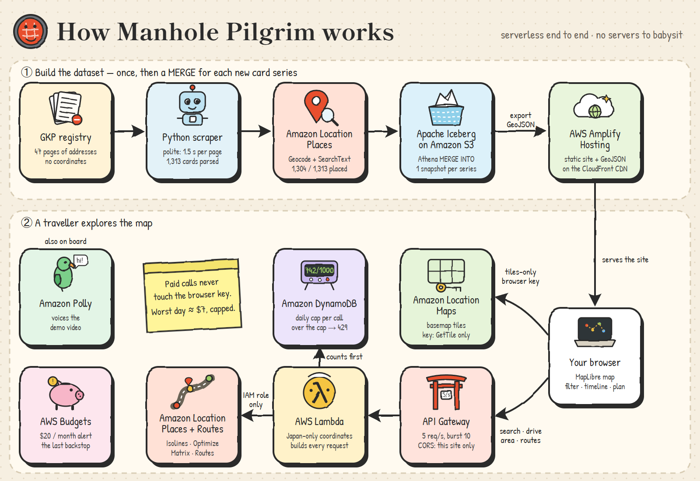

**Japan hid its sewers underground, then printed them as trading cards. I put all 1,313 on one map, so a traveller can see how many they can collect this weekend and get a route there.**

- 🗺️ **Live map:** https://main.d1y4wxk0wltj16.amplifyapp.com
- 🎬 **Demo video (2:33):** _YOUTUBE_LINK_
- 💻 **Code (MIT):** https://github.com/cnusergroup/manhole-pilgrim

Picture a Saturday in Kyoto. The temples are packed. Twenty minutes away, a sewage treatment plant hands out a free card with a hand-designed manhole cover on it. You can only get that card by walking up to its counter. Nobody on the tourist trail knows the plant is there, and the official list won't show you on a map how close it is.

This project fixes that for the whole country.


## At a glance

- **Dataset:** the official manhole card registry. It lists 1,313 cards across 29 series (2016 to 2026) and all 47 prefectures, as free-text Japanese addresses with **no coordinates**.
- **Onto the map:** **Amazon Location Service Places** geocoded the counters, placing 1,304 of 1,313 to a street address or POI. The data is versioned as **Apache Iceberg on Amazon S3** with one snapshot per series, and exported by Athena to a static map on **AWS Amplify**.
- **What you can do:** filter by series, prefecture or place type, and replay ten years of releases. Pick any start point and drive time: **Routes `CalculateIsolines`** shows the cards you can reach, and **`OptimizeWaypoints`** plans the route.
- **Safe to leave online:** the browser only gets a tiles-only key. Every paid call goes through a rate-limited Lambda proxy with hard daily caps.
- **Reusable:** swap the scraper and the same pipeline maps temple stamps, station stamps or dam cards.

## What the map revealed

Once the data was on a map, things showed up that no list makes obvious.

**Every major tourist hub has manhole cards within an hour's drive.** I ran a 1-hour `CalculateIsolines` from each station and counted the cards inside:

| Start | Cards within a 1-hour drive | Issuing towns | At sewage plants |
|---|---:|---:|---:|
| Osaka Station | **120** | 72 | 40 |
| Tokyo Station | **118** | 46 | 17 |
| Kyoto Station | **106** | 66 | 40 |
| Nagoya Station | **71** | 50 | 27 |
| Hakata Station (Fukuoka) | **27** | 20 | 8 |
| Hiroshima Station | **25** | 11 | 0 |
| Sapporo Station | **18** | 11 | 4 |
| Naha (Okinawa) | **15** | 9 | 2 |

*(Counts move by a few cards with the traffic model's departure time.)*

And a few surprises:

- **1 in 5 cards (265)** can only be picked up at a **sewage or water plant**. The cards were designed to bring people into infrastructure they never see, and the map shows how literally that works.
- **The loneliest card** is on the Ogasawara Islands, **898 km** from any other card.
- **A Hyōgo card you can only get in Osaka.** My geocoder flagged it as a bad result. It wasn't: the treatment plant that hands it out sits just across the prefectural border.
- **98 cards wait at michi-no-eki roadside stations.** Manhole cards are a road-trip game.
- **3 cards at a single counter** in Chōsei, Chiba, the most efficient stop in the country.

## Why manhole cards


Japan has about 15 million manhole covers, and thousands are works of art. Towns cast their castles, festivals, flowers and mascots into the iron. Since 2016, local sewer agencies and the Sewerage PR Platform (GKP, 下水道広報プラットホーム) have turned these designs into **manhole cards**. Each card is free and shows one cover, its coordinates and its story.

There is one rule: **you can't buy them, mail-order them or trade them online.** You walk up to one specific counter, in one specific town, and ask. That makes them a good fit for travellers:

- **A free souvenir** in every town that issues one.
- **A reason to leave the tourist trail.** The 1,313 cards come from 783 issuers, mostly towns visitors would never otherwise pick.
- **On your way anyway.** 536 cards are handed out at tourist offices, roadside stations and museums.

## The dataset

| | |
|---|---|
| Source | Official registry at [gk-p.jp/mhcard](https://www.gk-p.jp/mhcard/), one HTML table per prefecture |
| Records | **1,313 cards**, series 1–29 (April 2016 → July 2026), 47 prefectures |
| Fields | issuer, card code, series, issue date, distribution place, free-text address, opening hours, stock status, image URL |
| Missing | **coordinates**. About 300 counters have a place name and no address at all |

The 47 pages were scraped once, with a 1.5-second delay between requests, and parsed with BeautifulSoup. The raw HTML is cached locally and not redistributed.

## How the data got onto the map

### 1. Geocoding: Amazon Location Places

Every counter goes through a validated cascade:

1. **`Geocode`** handles the free-text address. It copes with 大字/字/番地 forms and full-width digits, so `山口県萩市大字江向６０２番地` resolves to 江向602 with a match score of 1.0.
2. **`SearchText`**, biased to the municipality, finds counters that only have a name, such as 「なよろ観光まちづくり協会」. It also returns a POI **category**, which helps classify each counter as a sewage plant, tourist office, roadside station, museum and so on.
3. **Sanity checks.** A result must land within 60 km of its own municipality. Prefecture-level cards only need to land in the right prefecture. If an address explicitly names another prefecture, the address wins.
4. Both calls use **`IntendedUse: Storage`**, because the results are stored and republished.

The result: **1,005 counters located by street address and 299 by POI search.** The other 9 fall back to their municipality's centroid, are flagged in the UI, and are left out of route planning.

### 2. Versioning: Apache Iceberg on Amazon S3

The registry changes: new series every few months, cards that run out, counters that move. So the data lives in an **Iceberg table** (Parquet + zstd, partitioned by prefecture, AWS Glue Data Catalog), and every load is an Athena **`MERGE INTO`**.

- The backfill commits **one snapshot per series**, so the table's history *is* the programme's history.
- `SELECT count(*) FROM cards FOR VERSION AS OF <snapshot>` returns 30 cards after series 1, 74 after series 2, and so on up to 1,313.
- The site's GeoJSON is **exported from Iceberg**, never hand-edited, and the map's footer shows which snapshot it came from.

### 3. Exploring: Amazon Location Maps and Routes

- **Maps** draws the basemap: the Monochrome style in its dark scheme, rendered with MapLibre GL.
- **`CalculateIsolines`** draws the real drive-time area from any start point, and the app counts the cards inside it.
- **`OptimizeWaypoints`** turns the nearest cards into a loop with arrival times. **`CalculateRoutes`** draws the road-following line.


## What people can explore

- **Every card on one map**, colour-coded by the kind of place that hands it out. Filter by series, prefecture or place type, or search by city or card code. Click a card for its counter, opening hours and a link to the official page.
- **Ten years in ten seconds:** a timeline replays 2016 → 2026, one series at a time, and each new release glows as it lands.
- **Plan a trip:** search for a start point or click the map, then pick a driving budget from 30 minutes to 3 hours. You get the reachable cards and an optimized route.
- **Discoveries:** one-click jumps to the surprises listed above.
- It works on phones too. The panel moves to the bottom and the map keeps your route in view.

## What was hard

- **Addresses that aren't addresses.** Many entries are a building name plus a floor, a "weekdays only" note, or just a department name. Only about 77% of entries had a usable street address. Separating the place name from the address and falling back from `Geocode` to `SearchText` is what got 99% of cards onto the map.
- **Trusting the geocoder too much, then too little.** A distance check rejects matches that land far from the issuing town. But the first version of that check also "fixed" the Hyōgo card that really is in Osaka. The rule now defers to an address that explicitly names a prefecture.
- **Start points inside buildings.** From the middle of Sapporo Station, `OptimizeWaypoints` couldn't build a loop back to the start and returned an error. The app now reuses the road-snapped origin from `CalculateIsolines`. If optimization still fails, it orders the stops itself using real drive times from `CalculateRouteMatrix` and a 2-opt pass, and shows a one-way plan.
- **A public map can't keep secrets.** That led to the design below.

## Architecture: built to stay online safely



| AWS service | Role |
|---|---|
| **Amazon Location Service** | Places `Geocode` + `SearchText`; Maps tiles; Routes `CalculateIsolines`, `OptimizeWaypoints`, `CalculateRouteMatrix`, `CalculateRoutes` |
| **Amazon S3 + Apache Iceberg** (Athena, Glue) | Versioned dataset: one snapshot per series, `MERGE INTO` refreshes, time travel, export |
| **AWS Amplify Hosting** | Static site on the CloudFront CDN, no servers to run |
| **Amazon API Gateway + AWS Lambda** | Validating, rate-limited proxy for every paid Location call |
| **Amazon DynamoDB** | Atomic daily quota counter per operation |
| **Amazon Polly** | Narration for the demo video |

Anything the browser holds, anyone can copy. So rather than trying to hide a key, the design limits what a copied one can do:

- **The browser key only loads tiles.** It allows `geo-maps:GetTile`, only from this site's referer, and it expires automatically. It cannot call Places or Routes.
- **Paid calls go through a proxy.** Only the Lambda's IAM role can call Places and Routes. The Lambda builds each request itself: coordinates must be inside Japan, drive times must be 30, 60, 120 or 180 minutes, and a route can have at most 10 stops.
- **Spending has a ceiling.** API Gateway throttles to 5 requests/s. A DynamoDB conditional counter enforces a daily cap for each operation (route-matrix calls are counted per route, which is how they are billed), and answers HTTP 429 beyond it. An AWS Budget alert is the last backstop.

The proxy is a single CloudFormation template. `scripts/test_proxy.py` checks every operation and every guard rail.

## Reuse the pattern

"Collect it in person" datasets are everywhere: temple stamps (御朱印), station stamps (駅スタンプ), dam cards (ダムカード), michi-no-eki stamp rallies, brewery passports. They usually ship as addresses and change over time. Replace the scraper and parser and keep everything else:

```
scrape → parse → Amazon Location Places (validated geocoding) → Iceberg MERGE (one snapshot per release)
       → Athena export → static map on Amplify → tiles-only key + rate-limited, capped Lambda proxy for routing
```

The README has two deployment paths: the map online from the committed data in about 10 minutes, or a full rebuild. It also lists IAM permissions, costs and clean-up commands.

## Data and rights

- The registry is used as factual listing data (place names, public facility addresses, opening hours) with attribution to GKP. It contains no personal data.
- **Card artwork is © the issuing municipalities and GKP.** This repository does not copy it. The live map links to the official image on the official server, and the demo video and this article use original illustrations instead.
- Basemap and geocoding data © AWS, HERE.

---

*Built for the AWS Builder Center "Map It" weekend challenge. Pick a station, pick an hour, and go find the sewers.*
